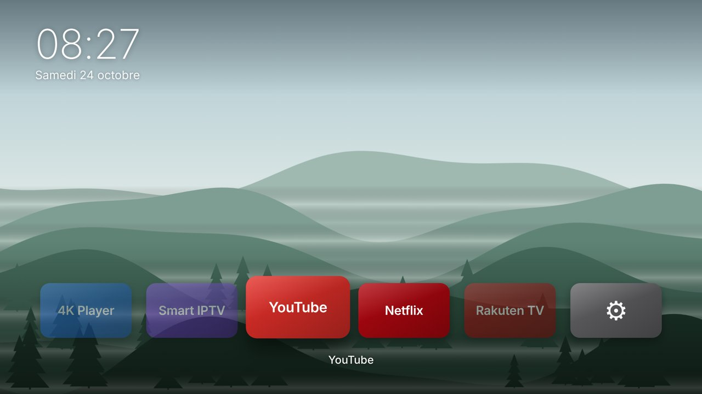

# Alléger une TV LG (webOS) et installer un accueil façon Apple TV



Ce kit se lance **depuis un ordinateur connecté au même Wi-Fi que la TV** (Windows, macOS ou Linux, Python 3.8+).
Il ne désinstalle rien et n'a pas besoin de rooter la TV : toutes les modifications sont notées et
`restaurer.py` les annule.

> **Pourquoi pas ADB ?** Les TV LG tournent sous webOS, pas Android : ADB n'y existe pas.
> Le kit utilise l'API réseau officielle « LG Connect » (ports 3000/3001) pour trouver la TV,
> sauvegarder la liste des applis, prendre des captures et lancer des applis, et les outils
> développeur LG pour installer l'écran d'accueil.

## Ce qu'il faut savoir avant de commencer

- **Réglages faits à la télécommande.** Sans root, webOS ne laisse aucun programme modifier les réglages
  de pub et de télémétrie. `lgtv.py alleger` te guide écran par écran, pose une question avant chaque
  fonction que tu pourrais utiliser, prend une capture **avant/après** et enregistre tout pour la restauration.
- **Pas de désinstallation.** Les applis système ne peuvent pas être désactivées sans root. On les pousse
  en fin de ruban, ce qui est réversible.
- **L'accueil Zen est une appli.** Il ne remplace pas l'accueil LG au démarrage (webOS l'interdit).
  Mets-le en tête du ruban et assigne-lui une touche chiffre (appui long sur un chiffre de la télécommande).
- **Developer Mode à renouveler.** L'appli « Developer Mode » de LG a un compteur de session
  affiché à l'écran. Ouvre-la et appuie sur « Extend » avant qu'il expire, sinon LG retire l'Accueil Zen
  (rien d'autre n'est touché ; `python lgtv.py installer` le remet).
- **Captures.** Certains modèles ou contenus protégés (Netflix…) bloquent la capture d'écran.
  L'outil le signale ; prends alors une photo avec ton téléphone.

## Étapes

```bash
cd lg-tv

# 1. Trouver et appairer la TV (accepte la demande à l'écran avec OK)
python lgtv.py trouver          # ou : python lgtv.py trouver 192.168.1.42
python lgtv.py appairer

# 2. Sauvegarde AVANT toute modification (applis, ordre du ruban, infos, capture)
python lgtv.py sauvegarder

# 3. Alléger : réglages guidés, questions, captures avant/après
python lgtv.py alleger          # « q » pour s'arrêter ; on peut reprendre plus tard

# 4. Écran d'accueil
python lgtv.py dock             # relie 4K Player, Smart IPTV, YouTube, Netflix, Rakuten TV
python lgtv.py dock "Disney+"   # (exemple) ajoute d'autres applis au dock
python lgtv.py fonds 12         # photos nature libres de droits (Wikimedia Commons)
npm install -g @webos-tools/cli # outils LG, une seule fois (Node.js requis)
python lgtv.py installer        # guide l'activation du Developer Mode puis installe

# Vérifier à tout moment
python lgtv.py capture apres-reglages
```

Pour PowerShell sous Windows, remplace `python` par `py` si besoin.

## Tout restaurer

```bash
python restaurer.py                                   # dernière sauvegarde
python restaurer.py sauvegardes/2026-10-24_20-15-00   # une sauvegarde précise
```

Le script désinstalle l'Accueil Zen (la seule appli ajoutée par le kit), te guide pour annuler chaque
réglage changé (en commençant par le dernier) en te montrant la capture d'origine, vérifie qu'aucune
appli ne manque et prend une capture finale. L'ordre d'origine du ruban est dans
`sauvegardes/<date>/ruban_accueil.txt`. Pour finir, tu peux désactiver « Dev Mode Status » dans
l'appli Developer Mode.

## Ce que le kit propose de changer

| Réglage | Question posée avant ? | Effet |
|---|---|---|
| Promotion de l'accueil | non (pub pure) | supprime la bannière de pub |
| Recommandation de contenu | non | supprime les rangées sponsorisées |
| Limiter le suivi publicitaire | non | plus de profil publicitaire |
| Informations de visionnage | non | coupe la télémétrie de visionnage |
| Live Plus | oui, fonctions interactives TV | coupe l'analyse de l'image (ACR) |
| Reconnaissance vocale | oui, commande vocale | coupe l'envoi de la voix |
| AirPlay | oui, iPhone/Mac | un service de moins |
| Lancement auto de l'accueil LG | non | démarrage sans pubs |
| Démarrage rapide+ | oui, conso en veille | allumage en ~2 s |
| LG Channels | oui, chaînes gratuites | retire les chaînes avec pubs |
| Ruban d'applis | non | réordonne, sans rien supprimer |
| DNS anti-pub (AdGuard) | oui, réseau | bloque les serveurs de pub LG |

La liste complète avec les chemins de menu est dans [`reglages.py`](reglages.py). Les noms de menu
correspondent à webOS 22 à 25 ; sur les modèles plus anciens ils sont proches mais rangés ailleurs.

## L'Accueil Zen

- Horloge et date, dock centré, tuile active agrandie, nom de l'appli dessous.
- Télécommande : ◀ ▶ pour choisir, OK pour lancer. Avec la Magic Remote, survole et clique.
- Après 15 s sans action, le dock s'efface pour laisser la photo seule ; n'importe quelle touche le ramène.
- Fonds : les photos de `launcher/wallpapers/` (tu peux y déposer tes propres .jpg en 1920×1080),
  sinon 6 paysages dessinés intégrés (montagnes, lac, océan, aurore boréale, dunes, collines).
  Ils fonctionnent hors ligne.
- Réglages dans `launcher/config.json` : `rotateSeconds`, `idleSeconds`, `slowZoom`, `clock24h`.
- Aperçu sur ordinateur : `cd launcher && python -m http.server` puis http://localhost:8000.

## Tests

`python tests/test_kit.py` lance tout le parcours (appairage, sauvegarde, dock, allègement,
restauration) contre une fausse TV simulée localement.
